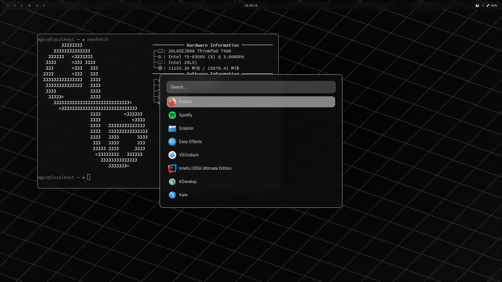
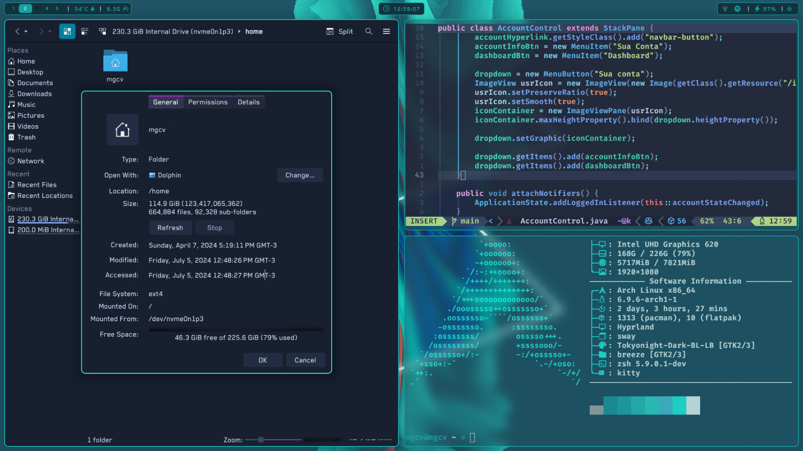
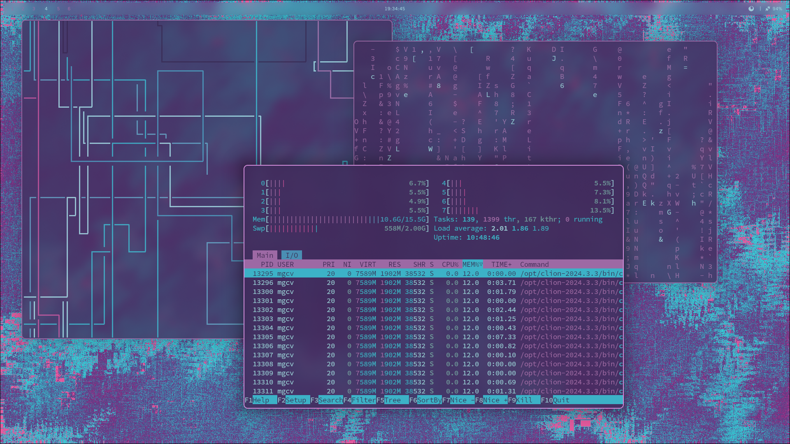
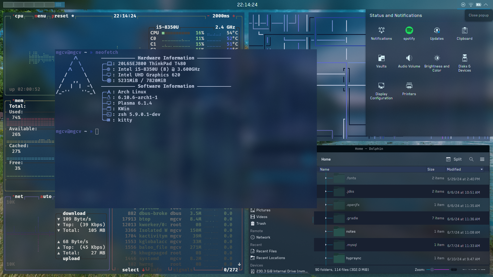

### Screenshots




### KDE



## Installation

- Install the desktop dependencies listed in `packages.txt`. Building the Waybar underline also needs a C compiler, `pkg-config`, and GTK 3 development headers/libraries (`gtk3-devel` on openSUSE).
- Copy the contents of `config/` into `~/.config`, preserving symlinks and executable permissions. The current Hyprland config lives in `config/hypr/`; there is no separate top-level Hyprland config to install.
- Install the bundled Bricolage Grotesque font and build the underline module:

```sh
mkdir -p ~/.local/share/fonts/BricolageGrotesque
cp font/BricolageGrotesque/* ~/.local/share/fonts/BricolageGrotesque/
fc-cache -f ~/.local/share/fonts/BricolageGrotesque
sh ~/.config/waybar/cffi/build.sh
```

- Before the first Hyprland start, initialize pywal's generated colors and the bar's surface tint:

```sh
wal -n -f ~/.config/wal/palettes/dark.json
python3 ~/.config/waybar/scripts/portfolio_surface.py
```

- Copy `firefox/chrome` into your Firefox profile and set `toolkit.legacyUserProfileCustomizations.stylesheets` to `true` in `about:config`.

These are personal dotfiles; some paths target `/home/mgcv`. Adjust those paths when installing under another account. The wallpaper scripts use `~/Pictures/wallpapers`; the images are in `wallpaper/` in this repository.

### Waybar and themes

The default `portfolio` theme uses pywal colors, translucent glass, Bricolage Grotesque, and a shared sliding workspace underline. Workspace numbers and battery text are 14px; the clock is 16px. The black and white palettes have their own subtle surface tints. `crystal_pywal` remains available through **Super + Ctrl + B**.

The underline's source, tests, and rebuild instructions are in [config/waybar/cffi](config/waybar/cffi/README.md). Its shared library and Python bytecode are generated locally and are not tracked. Rebuild and restart Waybar after changing its C source.

Hyprland configs and scripts use the flat `configs/` and `scripts/` layout with snake_case filenames. The obsolete duplicate config tree, extra Waybar layouts and themes, Rofi resolution variants, unused icons, and old Qt/Kvantum themes have been removed. Desktop animations remain disabled; the Waybar underline animates independently.

### Keybinds

I have custom keybinds setup in hyprland (capslk + j for left arrow, capslk + m for delete, etc).
For them to run properly, you must install keyd, and apply the propper configs (see /etc/keyd/default.conf)
